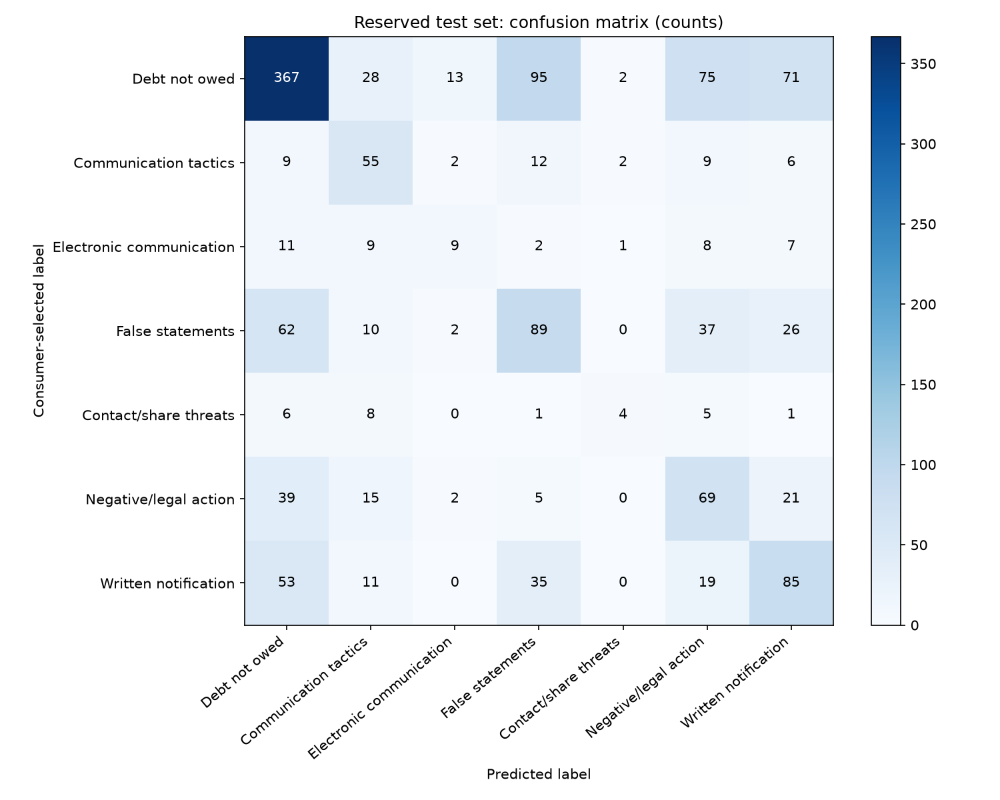
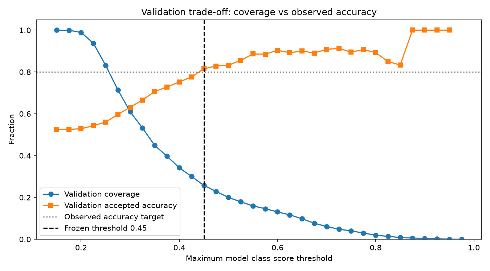

# 阶段 3：独立评估与人工复核

评估日期：2026-10-28。模型保持阶段 2 的固定参数，未重新训练。
测试前先校验验证及测试 CSV 的 SHA-256 与训练审计一致；先落盘冻结验证规则，再读取测试标签计算指标。
本次没有用测试结果调整模型、类别、数据划分或门槛。

## 测试集整体表现

独立测试：2024-12-22 至 2024-12-31，1,398 条。

| 模型 | Accuracy | Macro-F1 |
|---|---:|---:|
| 最多类别基线 | 46.57% | 0.0908 |
| TF-IDF + LogisticRegression | 48.50% | 0.3888 |

Accuracy 是全部样本中预测正确的比例。Macro-F1 对每个类别的 F1 等权平均；F1 同时考虑该类预测的准确程度（Precision）和找回该类样本的能力（Recall）。
基线与模型的整体 Accuracy 差距不大；模型的 Macro-F1 更高，说明它能识别多个类别，但整体仍有明显错误。

## 各类别独立测试表现

| 原始 Issue | Precision | Recall | F1 | 样本数 |
|---|---:|---:|---:|---:|
| Attempts to collect debt not owed | 0.671 | 0.564 | 0.613 | 651 |
| Communication tactics | 0.404 | 0.579 | 0.476 | 95 |
| Electronic communications | 0.321 | 0.191 | 0.240 | 47 |
| False statements or representation | 0.372 | 0.394 | 0.383 | 226 |
| Threatened to contact someone or share information improperly | 0.444 | 0.160 | 0.235 | 25 |
| Took or threatened to take negative or legal action | 0.311 | 0.457 | 0.370 | 151 |
| Written notification about debt | 0.392 | 0.419 | 0.405 | 203 |

小类别样本少、表现弱，不应把总体结果解释为所有类别都可靠。

混淆矩阵行是消费者选择的标签，列是模型预测；对角线是与原始标签一致的数量，其他格是分类分歧。
例如“不欠该债务”的 651 条中，有 95 条被预测为“虚假陈述”，75 条被预测为“负面或法律行动”，71 条被预测为“书面通知”。
标签是消费者选择，不是专家核实的绝对真值；这些分歧不能自动证明模型或投诉者哪方一定正确。

## 验证集选择的复核规则

提前确定选择标准：分数门槛网格 0.15–0.975，步长 0.025；达到门槛的验证样本至少 100 条，观察 Accuracy 至少 80%，选择覆盖最多的门槛。
如果没有候选合格，规则为全部建议复核。没有根据测试表现回调门槛。
实际选择 **0.45**；分数低于门槛标记 needs_review=true，等于门槛不标记。

| 结果 | 验证集 | 独立测试集 |
|---|---:|---:|
| 总样本 | 1,428 | 1,398 |
| 未标记复核 | 368 | 325 |
| 未标记覆盖率 | 25.77% | 23.25% |
| 未标记部分 Accuracy | 81.52% | 70.77% |
| 未标记部分 Macro-F1（7 类等权） | 0.5860 | 0.6278 |
| 建议人工复核 | 1,060 | 1,073 |
| 捕获全部分类错误的比例 | 89.96% | 86.81% |
| 未标记部分仍有的错误 | 68 | 95 |

**测试结果未达到 80% 目标。** 规则只能作为有限提示，不能作为放心自动处理的依据。
分数高不保证正确，低分不能可靠检测未知类别；模型分数不是经过校准的真实正确概率。
“覆盖率”是模拟情况下不被规则标记的比例，系统没有实际自动分派、退款或回复任何投诉。
门槛是从验证集多次比较选出的，验证表现可能偏乐观；测试揭示了这种局限。
未标记部分的类别支持量不同（测试最小类别只有 6 条），不能直接和完整测试集 F1 当作同一人群比较。

## 错误案例（不公开投诉全文）

本地保存按模型分数从高到低的前 5 个测试错误，以及截断正文和对应 ID。这种选择刻意暴露高分错误，不代表全部错误分布。

- 原始“不欠该债务”被预测为“负面或法律行动”，分数约 0.8795，规则未标记。正文同时包含债务验证和权利主张。
- 原始“不欠该债务”被预测为“书面通知”，分数约 0.8785，规则未标记。正文同时提到不知道该债务及未收到通知。
- 原始“不欠该债务”被预测为“虚假陈述”，分数约 0.7699，规则未标记。

这些文本可能包含多个问题，单标签无法覆盖全部诉求。两个最高分错误有近似模板，但非规范化后完全相同正文；当前去重没有消除全部相似模板。
这些是可见内容的描述和可能的误差解释，不是经过验证的根因诊断。

## 检查与文件

- 6 个单元测试通过，包括重复泄漏防护、阈值边界、没有合格门槛时全部复核。
- 模型未重新拟合；规则文件记录模型 SHA-256，命令行推理会验证规则与模型匹配。
- 本地 artifacts/test_metrics.json 保存完整 Precision/Recall/F1、支持量、混淆矩阵及规则指标。
- 本地 artifacts/test_predictions.csv 保存每条原文、原始标签、预测、分数和复核标记。
- 本地 artifacts/error_examples.json 保存错误案例；artifacts/evaluation.log 保存运行过程，不记录正文。
- 共享版本不上传这些原始行文件、模型或本机元信息，仅保留代码、汇总和图表。

仍有公开样本选择偏差、标签噪声、类别不均衡、近似模板和时间跨度短等限制。首版是辅助浏览与复核的学习原型，不能声称支持真实欺诈判定、根因诊断或公司排名。
阶段 4 图形界面尚未开始，等待用户确认。
